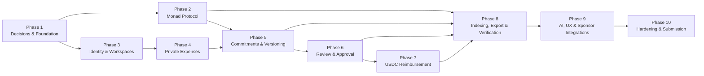

# Clario — Implementation Phases

**Document status:** Execution roadmap  
**Version:** 1.0  
**Companion documents:** [PRD](./prd.md) · [Architecture](./architecture.md)  
**Primary network:** Monad  
**Primary track:** Trust, Identity & AI Infrastructure  
**Secondary track:** Consumer Products & Payments  

---

## 1. Purpose

This roadmap converts Clario's product and architecture into an ordered build plan. Each phase produces a reviewable increment, names its dependencies, and defines objective acceptance criteria. A phase is complete only when its exit gate passes; a feature that exists in code but cannot be demonstrated or verified is incomplete.

The roadmap optimizes for one strong hackathon story:

> A contributor submits a private expense, an authorized reviewer approves the exact committed version, a material correction invalidates that approval, treasury reimburses the corrected version in USDC on Monad, and an independent verifier proves the final record has not been altered.

---

## 2. Delivery rules

### 2.1 Priority levels

- **P0:** Required for a coherent hackathon submission.
- **P1:** Materially strengthens judging, usability, or a sponsor bounty.
- **P2:** Post-MVP upgrade or optional fallback.

### 2.2 Definition of phase complete

A phase is complete when:

1. All P0 deliverables for the phase exist.
2. Acceptance criteria pass in the intended environment.
3. Required tests pass.
4. Setup and operational instructions are documented.
5. No unresolved defect blocks the next phase.
6. Any deferred item is recorded with its impact.

### 2.3 Scope rule

P0 work follows the critical path. P1 work may proceed only when it does not delay the next P0 exit gate. P2 work begins after the full end-to-end workflow passes.

### 2.4 Evidence rule

Every phase must leave review evidence:

- Source commit or diff
- Test output
- Deployed URL or transaction where applicable
- Screenshot or short recording for user-facing flows
- Updated configuration or deployment manifest
- Known limitations

---

## 3. Phase dependency map



### Critical path

```text
Phase 1 → Phase 2/3 → Phase 4 → Phase 5 → Phase 6 → Phase 7 → Phase 8 → Phase 10
```

Phase 9 contains P1 improvements. The project may enter Phase 10 without all Phase 9 features if the complete P0 workflow is already polished and stable.

### Parallel work

- Phase 2 contracts and Phase 3 application identity can proceed in parallel after Phase 1.
- UI shell and component design can proceed alongside Phase 2 using typed mocks.
- Verifier library scaffolding can begin after the Phase 1 canonical schema is frozen.
- Envio schema work can begin when Phase 2 events are finalized.
- Demo narrative, README outline, and diagrams can evolve throughout all phases.

---

## 4. Milestone overview

| Phase | Outcome | Depends on | Priority gate |
|---|---|---|---|
| 1 | Decisions, schemas, environments, and repository foundation are fixed | None | P0 |
| 2 | Monad contracts enforce roles, versions, decisions, and settlement safety | Phase 1 | P0 |
| 3 | Users authenticate and operate inside isolated role-based workspaces | Phase 1 | P0 |
| 4 | Users create expenses and store private evidence safely | Phase 3 | P0 |
| 5 | Expense versions are canonically hashed and anchored on Monad | Phases 2 and 4 | P0 |
| 6 | Authorized reviewers approve exact versions and edits invalidate approval | Phase 5 | P0 |
| 7 | Treasury reimburses the approved current version in USDC on Monad | Phase 6 | P0 |
| 8 | Indexed timelines, exports, and independent verification close the trust loop | Phases 2, 5, 6, and 7 | P0 |
| 9 | AI, sponsored gas, provider perks, analytics, and UX improve the product | Phase 8 | P1 |
| 10 | Security, accessibility, deployment, demo, and submission are complete | All required phases | P0 |

---

## 5. Phase 1 — Product decisions and foundation

### Objective

Remove foundational ambiguity before implementation. Freeze the first user story, schemas, selected providers, network, and engineering conventions.

### Dependencies

None.

### Work packages

#### P1.1 — Freeze the MVP journey — P0

- Define the target workspace: a small crypto team reimbursing a contractor.
- Define three demo actors: submitter, approver, and treasury.
- Confirm the required happy path and correction path.
- Confirm which fields are material to approval.
- Confirm what the verifier proves and does not prove.

#### P1.2 — Confirm hackathon requirements — P0

- Recheck [Metropolis tracks](https://hackathon.monad.xyz/tracks).
- Recheck [Metropolis resources](https://hackathon.monad.xyz/resources).
- Record submission deadline, required network, judging rules, and eligible bounties.
- Select Trust, Identity & AI Infrastructure as primary.
- Select Consumer Products & Payments as secondary only when a real Monad USDC reimbursement is included.
- Record technical evidence required by each selected sponsor.

#### P1.3 — Select the implementation stack — P0

Default selection:

- Next.js PWA
- Privy smart wallet
- Viem
- Solidity and OpenZeppelin
- Foundry or Hardhat
- QuickNode Monad RPC
- Envio HyperIndex
- Tenderly
- Zerion API
- PostgreSQL
- Private S3-compatible object storage
- Supported Monad USDC

Alchemy may replace the Privy plus QuickNode wallet/RPC path. The decision must be made before wallet implementation.

#### P1.4 — Freeze public and private schemas — P0

- Define `workspaceId`, `expenseId`, and version rules.
- Define the canonical expense schema.
- Define the evidence manifest schema.
- Define material fields.
- Define contract events.
- Define the verification package structure.
- Create at least three golden commitment vectors.

#### P1.5 — Establish repository quality gates — P0

- Document local setup and environment variables.
- Configure formatting, linting, unit tests, and contract tests.
- Add secret scanning and ignore rules.
- Define branch and release conventions.
- Add deployment-manifest schema.

#### P1.6 — Claim participant resources — P1

- Claim QuickNode Build Plan.
- Claim Tenderly Pro tier.
- Claim Zerion API Builder tier.
- Confirm Privy, Envio, Alchemy, or other sponsor onboarding requirements.

### Deliverables

- Final MVP scope
- Architecture decisions
- Provider decision record
- Canonical schema v1
- Evidence manifest v1
- Contract event specification
- Golden hash fixtures
- Environment template without secrets
- Hackathon eligibility checklist

### Acceptance criteria

- [ ] A new engineer can describe the complete demo path without inventing requirements.
- [ ] Public and private fields are explicitly separated.
- [ ] Every material edit is defined.
- [ ] Golden vectors include canonical bytes, salt, intermediate hashes, and final commitment.
- [ ] One wallet stack and one primary indexer are selected.
- [ ] Required network and USDC address source are documented.
- [ ] Selected bounties have current eligibility notes and proof requirements.
- [ ] No secret or private key exists in source control.

### Exit gate

The team can implement contracts and application schemas independently and still produce identical expense commitments.

---

## 6. Phase 2 — Monad protocol foundation

### Objective

Build and deploy the minimal onchain protocol that makes Clario verifiable.

### Dependencies

- Phase 1 canonical schema
- Phase 1 contract event specification
- Confirmed Monad network configuration

### Metropolis resources

- [Differences from Ethereum](https://docs.monad.xyz/developer-essentials/differences)
- [Gas pricing](https://docs.monad.xyz/developer-essentials/gas-pricing)
- [Opcode pricing](https://docs.monad.xyz/developer-essentials/opcode-pricing)
- [Reserve balance](https://docs.monad.xyz/developer-essentials/reserve-balance)
- [Deploy contracts](https://docs.monad.xyz/guides/deploy-smart-contract/index)
- [Verify contracts](https://docs.monad.xyz/guides/verify-smart-contract/index)

### Work packages

#### P2.1 — Workspace and role registry — P0

- Create opaque workspaces.
- Grant and revoke owner, admin, approver, and treasury roles.
- Add scoped role support or document MVP global-workspace scope.
- Emit complete role and policy events.

#### P2.2 — Expense version registry — P0

- Register immutable commitments.
- Enforce version sequence.
- Require valid predecessor commitment.
- Track the current version.
- Emit submission and supersession events.

#### P2.3 — Decision registry — P0

- Record approval, rejection, and change request.
- Bind decisions to exact version and commitment.
- Check reviewer authority.
- Prevent replay.
- Expose current approval validity.

#### P2.4 — Settlement guard — P0

- Require current approved version.
- Bind token, recipient, amount, and commitment.
- Prevent duplicate standard reimbursement.
- Support contract-mediated USDC transfer or verified external-transfer reference.

#### P2.5 — Contract testing — P0

- Unit-test every role and transition.
- Fuzz identifiers, versions, amounts, nonces, and scopes.
- Add invariants for current approval and settlement.
- Test malicious token/reentrancy behavior if transfers occur in-contract.
- Measure representative gas.

#### P2.6 — Deploy and verify — P0

- Deploy to the selected Monad environment.
- Verify source on a supported explorer.
- Publish ABI, address, deployer, block, transaction, source commit, and ABI hash.
- Store values in a deployment manifest.

### Acceptance criteria

- [ ] Unauthorized role changes and decisions revert.
- [ ] Duplicate version numbers revert.
- [ ] Invalid predecessor commitments revert.
- [ ] Approval of a superseded version cannot become current.
- [ ] A stale approval cannot authorize reimbursement.
- [ ] A second reimbursement of the same version is blocked.
- [ ] Events contain no private expense data.
- [ ] Contract source is verified and linked.
- [ ] Deployment manifest matches the deployed bytecode and application ABI.
- [ ] Contract test suite and critical invariants pass.

### Exit gate

Using only contract calls, distinct wallets can create a workspace, assign an approver, submit two versions, prove version 1 approval is stale, approve version 2, and record one settlement.

---

## 7. Phase 3 — Identity, onboarding, and workspaces

### Objective

Give users a clear way to enter Clario, create a team, and act under enforceable roles.

### Dependencies

- Phase 1 provider decision
- Phase 1 workspace schema
- Phase 2 role interface may be mocked until deployed

### Metropolis resources

- [Privy smart-wallet PWA template](https://docs.monad.xyz/templates/next-serwist-privy-smart-wallet)
- [Privy embedded-wallet PWA template](https://docs.monad.xyz/templates/next-serwist-privy-embedded-wallet)
- [Alchemy Smart Wallets](https://www.alchemy.com/docs/wallets/quickstart) as the approved alternative
- [EIP-7702](https://docs.monad.xyz/developer-essentials/eip-7702) if used
- [EIPs for Designers](https://www.eipsfordesigners.com/) for signing and network UX

### Work packages

#### P3.1 — Authentication — P0

- Implement chosen wallet or embedded-wallet login.
- Verify sign-in nonce and domain server-side.
- Create secure session handling.
- Validate Monad chain before write actions.
- Implement disconnect and session expiry.

#### P3.2 — Workspace onboarding — P0

- Create workspace.
- Add owner identity.
- Invite by wallet address; email invitation is P1.
- Assign submitter, approver, and treasury roles.
- Track pending and confirmed role transactions.

#### P3.3 — Authorization — P0

- Enforce workspace isolation on every private API.
- Enforce role and scope in backend and UI.
- Recheck authority onchain for critical actions.
- Preserve historical actions after role revocation.

#### P3.4 — Onboarding experience — P1

- Explain Clario in one screen.
- Guide owner through workspace, first expense, and approver invitation.
- Provide useful empty states.
- Hide unnecessary wallet jargon while keeping signatures understandable.

### Acceptance criteria

- [ ] First-time user reaches a workspace through the selected login path.
- [ ] Wrong-network writes are blocked with a recovery action.
- [ ] Client-supplied wallet addresses are never trusted without signature/session proof.
- [ ] Workspace A cannot read or mutate Workspace B.
- [ ] Submitter cannot grant roles.
- [ ] Revoked approver cannot submit a new valid decision.
- [ ] Role transactions show pending, confirmed, rejected, and failed states.
- [ ] No private keys or wallet secrets pass through Clario servers.

### Exit gate

Three distinct demo identities can enter one workspace and see only the actions allowed by their roles.

---

## 8. Phase 4 — Private expenses and evidence

### Objective

Let a contributor create a complete expense while keeping evidence private and recoverable.

### Dependencies

- Phase 3 authentication
- Phase 3 workspace authorization
- Phase 1 private schema
- Database and object-storage environments

### Metropolis resources

- [Zerion API](https://developers.zerion.io/introduction)
- [Zerion CLI](https://developers.zerion.io/build-with-ai/zerion-cli) for integration diagnostics
- [Vana](https://docs.vana.org) as a grant-gated data architecture reference
- [C2PA specification](https://spec.c2pa.org) as evidence-manifest reference

### Work packages

#### P4.1 — Transaction import — P0

- Query supported wallet activity through Zerion.
- Normalize chain, transaction, addresses, asset, amount, time, and status.
- Link to the source-chain explorer.
- Support transaction-hash paste and manual entry fallback.
- Preserve provider and raw-reference provenance.

#### P4.2 — Expense drafts — P0

- Create autosaved drafts.
- Capture title, purpose, category, project, amount, asset, date, merchant, reimbursement address, and source payment.
- Validate required fields.
- Warn on probable duplicate source transactions.

#### P4.3 — Evidence upload — P0

- Accept PDF, PNG, and JPEG within explicit limits.
- Validate actual file type and size.
- Encrypt every object with authenticated envelope encryption.
- Use private storage and short-lived authorized downloads.
- Create a C2PA-inspired evidence manifest.

#### P4.4 — Evidence authorization — P0

- Enforce record-level access on upload, preview, and download.
- Prevent public object URLs.
- Log access without logging private content.
- Support draft deletion and immutable submitted evidence.

### Acceptance criteria

- [ ] User can import at least one real source transaction.
- [ ] Manual entry works during provider failure.
- [ ] Failed or pending source payments are not shown as confirmed.
- [ ] Duplicate use of one transaction in a workspace shows a blocking or explicit warning.
- [ ] Evidence is unreadable directly from storage without authorization.
- [ ] Tampering changes the evidence hash.
- [ ] No receipt content or private metadata appears in URLs or logs.
- [ ] A submitted evidence object cannot be overwritten.

### Exit gate

A submitter can create a complete private draft from an imported or manual transaction, upload evidence, and preview the exact record that will be committed.

---

## 9. Phase 5 — Commitments and immutable versioning

### Objective

Connect private expense records to tamper-evident Monad commitments.

### Dependencies

- Phase 2 deployed registry
- Phase 4 expense and evidence records
- Phase 1 golden vectors

### Work packages

#### P5.1 — Canonicalization library — P0

- Implement stable field order and encoding.
- Normalize Unicode, timestamps, addresses, chain IDs, and base-unit amounts.
- Sort evidence deterministically.
- Version the schema.
- Share fixtures with the independent verifier.

#### P5.2 — Commitment generation — P0

- Generate cryptographically random 32-byte salts.
- Hash canonical record and evidence manifest.
- Apply domain separation for chain, registry, workspace, expense, and version.
- Store salts separately from public state.

#### P5.3 — Submission flow — P0

- Show normalized record before signing.
- Prepare contract transaction.
- Validate runtime chain ID.
- Track awaiting signature through confirmed event.
- Freeze the submitted version after confirmation.

#### P5.4 — Corrections and version diff — P0

- Copy current record into a new draft version.
- Mark material versus cosmetic changes.
- Submit a new commitment referencing the predecessor.
- Display old and new fields side by side.
- Preserve all authorized historical versions.

### Acceptance criteria

- [ ] Browser, server, and verifier reproduce every golden vector.
- [ ] Same data and salt produce the same commitment.
- [ ] Same data with a different salt produces a different commitment.
- [ ] Submitted versions cannot be mutated in storage.
- [ ] Material edits always create a new version.
- [ ] Monad event commitment equals the application commitment.
- [ ] UI distinguishes submitted from confirmed.
- [ ] Refresh or retry cannot create an accidental duplicate version.
- [ ] No salt or private record is emitted onchain.

### Exit gate

A private expense can be submitted as version 1, edited as version 2, and independently matched to both Monad commitments using authorized disclosed data.

---

## 10. Phase 6 — Review, approval, and trust

### Objective

Make human authority explicit and ensure every decision applies to exactly what the reviewer saw.

### Dependencies

- Phase 3 roles
- Phase 5 immutable versions
- Phase 2 decision registry

### Metropolis resources

- [Ethereum Attestation Service](https://docs.attest.org) as the credential/attestation model
- [EAS contracts](https://github.com/ethereum-attestation-service/eas-contracts) for revocation and resolver reference
- [C2PA privacy and truth analysis](https://worldprivacyforum.org/posts/privacy-identity-and-trust-in-c2pa/) for claims language

### Work packages

#### P6.1 — Review queue — P0

- List assigned submitted and reapproval-required expenses.
- Show source facts, private fields, evidence, version diff, and policy status.
- Display commitment and explorer link without overwhelming the user.

#### P6.2 — Decisions — P0

- Prepare approve, reject, and request-changes actions.
- Bind action to workspace, chain, registry, version, commitment, policy, nonce, and signer.
- Require reason for rejection and change request.
- Track transaction state.

#### P6.3 — Approval invalidation — P0

- Detect superseding versions from Monad/indexer.
- Mark old approval historical.
- Set current expense to `REAPPROVAL_REQUIRED`.
- Block reimbursement until current version is approved.

#### P6.4 — Attestation interoperability — P1

- Decide whether MVP uses a compact custom registry or EAS-compatible schemas.
- Document schema mapping either way.
- Preserve a future path for portable reviewer credentials and decisions.

### Acceptance criteria

- [ ] Unauthorized reviewer action fails.
- [ ] Self-approval fails unless explicitly enabled by policy.
- [ ] Reviewer sees the exact version and commitment being approved.
- [ ] Replaying an approval across chain, workspace, expense, or version fails.
- [ ] Version 2 immediately makes version 1 approval stale for settlement.
- [ ] Historical approval remains visible and correctly labeled.
- [ ] Rejection/change reason remains private while its commitment can be verified.
- [ ] UI never describes integrity verification as proof that a receipt is truthful.

### Exit gate

The live demo can approve version 1, change a material field, visibly invalidate approval, and approve version 2 with a distinct authorized wallet.

---

## 11. Phase 7 — USDC reimbursement on Monad

### Objective

Close the financial workflow with a real, safe Monad reimbursement linked to the current approved version.

### Dependencies

- Phase 6 valid current approval
- Phase 2 settlement guard
- Confirmed supported USDC contract and decimals
- Funded treasury demo wallet

### Metropolis resources

- [Circle Wallets, USDC, CCTP, and gas sponsorship on Monad](https://www.circle.com/blog/now-available-usdc-cctp-wallets-and-contracts-on-monad)
- [Monad cross-chain resources](https://docs.monad.xyz/tooling-and-infra/cross-chain) for optional CCTP
- [Tenderly](https://tenderly.co/) for simulation

### Work packages

#### P7.1 — Settlement preparation — P0

- Recheck current version and approval onchain.
- Resolve canonical token address and decimals.
- Compare approved recipient and amount.
- Check treasury balance, allowance, and Monad reserve balance.
- Display complete payment intent.

#### P7.2 — Simulation and execution — P0

- Simulate allowance and reimbursement calls.
- Execute contract-mediated transfer or supported verified external transfer.
- Track transaction and expected token/registry events.
- Provide safe recovery for rejection or failure.

#### P7.3 — Settlement verification — P0

- Confirm token contract, payer, recipient, amount, transaction status, and registry reference.
- Set `REIMBURSED` only after expected confirmed events.
- Block duplicate standard reimbursement.

#### P7.4 — Cross-chain reimbursement — P1

- Use CCTP only if the supported source/destination path is confirmed and core settlement already passes.
- Track burn/mint or transfer states separately.
- Preserve manual recovery instructions.

### Acceptance criteria

- [ ] Unapproved and superseded versions cannot enter the normal payment flow.
- [ ] Token address, decimals, recipient, and amount are verified before signing.
- [ ] User sees allowance and payment as separate actions when required.
- [ ] Tenderly or equivalent simulation passes before payment.
- [ ] Failed transaction does not mark the expense reimbursed.
- [ ] Confirmed USDC transfer matches the approved version.
- [ ] Duplicate reimbursement attempt is blocked.
- [ ] Explorer link and settlement event are visible.

### Exit gate

Treasury reimburses the approved current expense in supported USDC on Monad, and a second attempt is safely rejected.

---

## 12. Phase 8 — Indexing, reports, export, and independent verification

### Objective

Make the complete workflow queryable and independently provable without trusting Clario's production database.

### Dependencies

- Final Phase 2 event schema
- Phase 5 commitments
- Phase 6 decisions
- Phase 7 settlement events

### Metropolis resources

- [Envio HyperIndex overview](https://docs.envio.dev/docs/HyperIndex/overview)
- [Envio quickstart](https://docs.envio.dev/docs/HyperIndex/quickstart)
- [Index Monad with Envio](https://docs.envio.dev/docs/HyperIndex/monad-testnet)
- [HyperSync](https://docs.envio.dev/docs/HyperSync/overview)
- [QuickNode Streams](https://www.quicknode.com/docs/streams) as fallback
- [QuickNode Webhooks](https://www.quicknode.com/docs/webhooks/getting-started) as fallback
- [C2PA](https://spec.c2pa.org) for manifest design

### Work packages

#### P8.1 — Event indexer — P0

- Index workspace, role, policy, version, decision, and settlement events.
- Build query projections.
- Make processing idempotent.
- Track block and log identity.
- Handle reorganization/replay.
- Keep private fields outside the public index.

#### P8.2 — Activity timeline and dashboard — P0

- Combine authorized private events with public chain events.
- Label pending versus confirmed.
- Show review, reapproval, unpaid, and reimbursed counts.
- Add filters required for the demo.

#### P8.3 — Operational exports — P0

- Export CSV with source transaction, version, approval, and settlement references.
- Generate a versioned verification package.
- Support full and redacted disclosures.
- Include deployment manifest and schema identifiers.

#### P8.4 — Independent verifier — P0

- Parse and validate package schema.
- Rebuild record and evidence hashes.
- Rebuild commitments.
- Query Monad through user-selectable RPC.
- Verify version order, signer authority, decisions, supersession, and settlement.
- Produce per-check and overall results.
- Run without Clario database access.

### Acceptance criteria

- [ ] Indexer restart does not duplicate events.
- [ ] Timeline can be reconstructed from indexed and private authorized events.
- [ ] Direct RPC validates critical state if indexer lags.
- [ ] CSV totals reconcile to filtered records.
- [ ] Valid package returns `VERIFIED` when every required check passes.
- [ ] Modified amount or evidence returns `FAILED` for the relevant check.
- [ ] Missing disclosure returns `UNVERIFIABLE`, not success.
- [ ] Superseded approval is identified.
- [ ] Settlement token, recipient, and amount are verified.
- [ ] Verifier requires no authenticated Clario API.

### Exit gate

A clean browser can load the exported package, verify the final record against Monad, then detect an intentionally tampered copy.

---

## 13. Phase 9 — AI, sponsored gas, and product upgrades

### Objective

Reduce user effort and strengthen sponsor-bounty execution after the trust loop works end to end.

### Dependencies

- Phase 8 P0 flow passing
- Selected sponsor requirements
- Privacy review for any provider receiving evidence

### Work packages

#### P9.1 — AI receipt extraction — P1

- Extract merchant, date, invoice number, currency, subtotal, tax, and total.
- Return field-level confidence.
- Suggest category, project, and candidate transaction.
- Require user confirmation.
- Record provider, model, prompt version, and corrections.

#### P9.2 — Risk and duplicate assistance — P1

- Flag receipt/payment amount mismatches.
- Flag date inconsistencies.
- Detect probable duplicate evidence and claims.
- Show explanations and allow human override with reason.

#### P9.3 — Sponsored transactions — P1

- Sponsor expense-commitment and approval transactions.
- Use Privy, Alchemy, Circle, or the selected eligible stack.
- Apply policy limits by action, workspace, actor, and time.
- Never sponsor unrestricted arbitrary calls.

#### P9.4 — Analytics and reporting — P1

- Add approval time, unpaid total, reimbursement time, and project/category views.
- Preserve source and timestamp for currency conversion.
- Add privacy-safe product telemetry.

#### P9.5 — Future agent interfaces — P2

- [x402](https://docs.monad.xyz/guides/x402#what-is-x402) paid verification API.
- [ERC-8004](https://docs.monad.xyz/guides/erc-8004) verifier-agent identity.
- [Trust8004](https://www.8004.org/build) discovery and reputation.
- Agent access remains read/verify-only until a separate security review.

### Acceptance criteria

- [ ] Every AI field is visibly a suggestion until confirmed.
- [ ] Invalid or low-confidence output cannot silently enter a commitment.
- [ ] Manual submission works when AI is unavailable.
- [ ] Receipt prompt injection cannot call tools or trigger application actions.
- [ ] Sponsored actions are limited to approved contracts and selectors.
- [ ] Removing a sponsor integration has a documented fallback.
- [ ] Every claimed bounty integration appears in the live demo and repository.

### Exit gate

A first-time user can submit and approve with minimal wallet friction, while AI/provider failure leaves the core manual workflow intact.

---

## 14. Phase 10 — Hardening, deployment, and hackathon submission

### Objective

Turn the working system into a reliable, understandable, and judge-ready product.

### Dependencies

- Phases 1–8 complete
- Selected Phase 9 features stable
- Final hackathon requirements reconfirmed

### Work packages

#### P10.1 — Security review — P0

- Review contract authorization and settlement invariants.
- Review object authorization and encryption.
- Scan events, calldata, URLs, logs, and analytics for private-data leaks.
- Test replay, duplicate, stale-version, malicious-upload, and prompt-injection cases.
- Replace or document any hackathon-only key shortcut.

#### P10.2 — Reliability — P0

- Test RPC, indexer, AI, Zerion, and storage failures.
- Add useful retry and recovery paths.
- Test transaction rejection, replacement, failure, and reorganization.
- Seed deterministic demo data while preserving real Monad interactions.

#### P10.3 — UX and accessibility — P0

- Polish onboarding, empty, loading, pending, success, and failure states.
- Verify mobile responsiveness.
- Verify keyboard navigation, focus, labels, contrast, and error association.
- Remove unnecessary chain jargon.
- Ensure signatures explain exact intent.

#### P10.4 — Documentation — P0

- Complete README.
- Link PRD, architecture, and phases.
- Publish setup, environment, deployment, and verification instructions.
- Add architecture diagram, contract addresses, ABI hashes, explorer links, and known limitations.
- Credit any starter template or adapted example.

#### P10.5 — Demo and submission — P0

- Rehearse the three-minute story with distinct identities.
- Record a fallback demo video.
- Capture live transaction and verifier links.
- Confirm track and bounty forms.
- Submit only integrations that meet current technical requirements.

### Acceptance criteria

- [ ] Full release test passes twice from clean sessions.
- [ ] All P0 automated checks pass.
- [ ] No known issue can leak evidence, validate stale approval, or duplicate settlement.
- [ ] Deployed runtime configuration matches deployment manifest.
- [ ] Contracts are verified.
- [ ] Application and verifier URLs work without developer setup.
- [ ] Demo completes within the target time.
- [ ] README explains what Monad does in Clario.
- [ ] Limitations clearly distinguish integrity from truth.
- [ ] Every selected bounty has implementation evidence.
- [ ] Submission links and video are accessible.

### Exit gate

Clario is submitted with a reproducible, deployed, and independently verifiable end-to-end workflow.

---

## 15. Cross-phase dependency register

| Dependency | Required by | Failure impact | Mitigation |
|---|---|---|---|
| Current Metropolis network rules | Phases 1, 2, 7, 10 | Wrong deployment or ineligible submission | Recheck at foundation and release gates |
| Canonical schema v1 | Phases 2, 4, 5, 6, 8 | App/verifier commitments disagree | Freeze early; golden vectors in all runtimes |
| Monad RPC | Phases 2, 5–10 | Cannot write or verify | QuickNode primary; documented fallback |
| Privy or selected wallet | Phases 3, 5–7, 9 | Cannot authenticate/sign | Provider-neutral wallet interface; standard wallet fallback |
| Envio | Phases 8–10 | Timeline/search delayed | Direct RPC for critical state; reindex capability |
| Zerion | Phase 4 | Multichain import unavailable | Hash paste and manual entry |
| Tenderly | Phases 2, 7, 10 | Reduced simulation/debug visibility | Local simulation and RPC estimate fallback |
| Object storage and keys | Phases 4–10 | Evidence unavailable | Backup, key procedure, clear degraded state |
| PostgreSQL | Phases 3–10 | Private workflow unavailable | Backups, migrations, recovery test |
| AI provider | Phase 9 | Extraction unavailable | Manual entry remains complete |
| Supported Monad USDC | Phases 7–10 | Payment story incomplete | Confirm early; use approved test asset only when rules permit |
| Block explorer verification | Phases 2 and 10 | Reduced transparency | Retry supported explorer; publish source and bytecode metadata |

---

## 16. Scope reduction order

If schedule risk appears, cut in this order:

1. Cross-chain CCTP reimbursement
2. Agent/x402/ERC-8004 features
3. Advanced analytics
4. Email notifications and invitations
5. Broad multichain support beyond one demonstrated source chain
6. AI anomaly scoring beyond basic extraction
7. EAS deployment if compact Clario roles already work
8. Gas sponsorship if standard signing remains usable

Do not cut:

- Private evidence
- Salted commitments
- Immutable versioning
- Approval invalidation after material edits
- Distinct authorized reviewer
- Real Monad transaction flow
- USDC reimbursement or verifiable Monad settlement
- Independent verifier
- Tamper-detection demonstration

---

## 17. Release test script

Run this exact sequence before submission:

1. Open a clean browser session.
2. Sign in as workspace owner.
3. Create a workspace.
4. Add distinct submitter, approver, and treasury identities.
5. Sign in as submitter.
6. Import a transaction through Zerion or use the documented fallback.
7. Upload a private receipt.
8. Confirm AI fields if enabled.
9. Submit expense version 1 and open its Monad transaction.
10. Sign in as approver and approve version 1.
11. Sign in as submitter and change the amount or evidence.
12. Submit version 2.
13. Confirm version 1 approval is marked superseded and reimbursement is blocked.
14. Sign in as approver and approve version 2.
15. Sign in as treasury and simulate reimbursement.
16. Reimburse version 2 in supported USDC on Monad.
17. Confirm the token transfer and settlement event.
18. Export the full verification package.
19. Verify it from a clean unauthenticated session.
20. Change one committed field or evidence file.
21. Confirm the verifier reports failure for the changed content.
22. Confirm README, explorer, contract, deployment, app, verifier, and video links.

The release fails if any step needs database edits, hidden admin intervention, reused private keys from source control, or an explanation that cannot be reproduced by a judge.

---

## 18. Final completion criteria

The implementation roadmap is complete when:

- Phases 1–8 and 10 pass their exit gates.
- Every P0 requirement in the PRD is implemented.
- Architecture invariants are enforced and tested.
- The selected Phase 9 integrations are stable and demonstrable.
- All selected Metropolis resources and bounties have traceable implementation evidence.
- Deferred resources are accurately described and do not appear as completed integrations.
- The live demo proves privacy, integrity, authority, correction safety, and Monad settlement in one uninterrupted story.

Clario should reach submission as a focused product with a complete trust loop, not as a collection of partially integrated sponsor tools.
